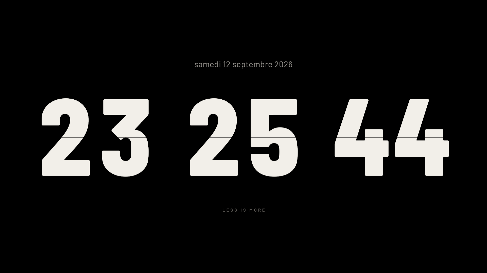
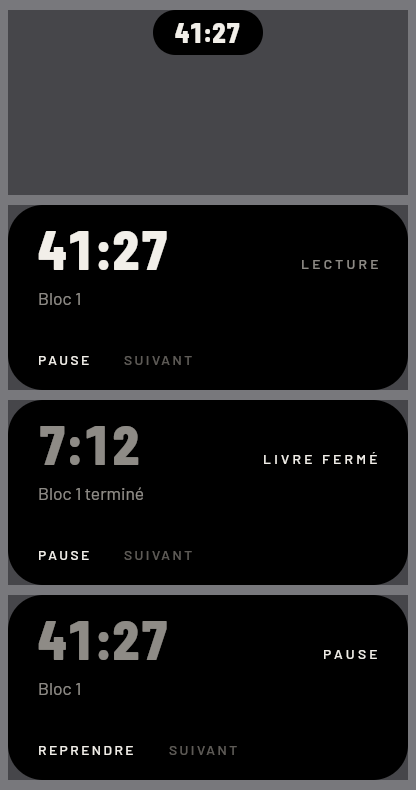

# Veilleuse

> **En bref (français).** Veilleuse est une horloge à volets plein écran et un îlot flottant
> de concentration pour les nuits de lecture, écrits en Rust natif (`winit`, `wgpu`,
> `glyphon`) sans aucune couche web : tout le rendu, y compris un verre taillé qui floute le
> bureau derrière l'îlot, est écrit à la main en WGSL. La documentation complète, en
> français, est dans [`LISEZ-MOI.md`](LISEZ-MOI.md).

**A full-screen flip clock and a floating study timer for reading at night, written in native
Rust with its own GPU renderer.**



## What it is

Two windows that work together:

- **The clock.** A black, full-screen flip clock in the spirit of Fliqlo, rendered by a
  custom `wgpu` pipeline: flap animation, a fold line that is the background showing through
  the digit, a palette tuned for a dark-adapted eye (pure `#000000` so an OLED panel switches
  off, a slightly warm white for the digits).
- **The island.** When another window is in front, a small rounded "pebble" floats above it and
  carries a study timer organised in blocks: a reading phase, then a "book closed" phase to
  recall what was read (durations and page ranges come from a small JSON file). Press and hold
  to expand it, click to bring the clock back, drag to move it (its position is remembered per
  screen).



## What is technically interesting

- **A glass that Windows does not provide.** Windows 11 can put an acrylic backdrop behind a
  window, but only a rectangle. The island is a superellipse, so Veilleuse does it itself: the
  window marks itself excluded from screen capture (`SetWindowDisplayAffinity` with
  `WDA_EXCLUDEFROMCAPTURE`), captures what is behind it, blurs and tints it on the GPU and
  masks it with its own shape, with a refracting, reflecting edge. The question that decides
  whether this can work at all (does a window that captures the screen see itself?) was tested
  with a control: 115,200 control pixels without the flag, 0 with it. The method and its
  measurements are written up as a short paper, [`article/verre-taille.pdf`](article/verre-taille.pdf)
  (in French).
- **A frost that grows.** Switching the pebble from opaque to glass is not a cut: the surface
  frosts over, then melts into glass. The frost is a crystal-growth simulation computed once on
  the CPU (tips advancing and branching at 60°, a mosaic of cells behind them) and stored in a
  texture that the shader reads every frame.
- **It follows the system.** Windows text size, high-contrast themes, transparency turned off,
  battery saver and reduced motion are all read and respected; without glass the island falls
  back to an opaque black pebble.
- **One icon, fourteen sizes.** `assets/veilleuse.ico` carries the exact set of sizes listed in
  Microsoft's icon scaling table (16 to 256 px), each one rendered by the app's own pebble
  shader, embedded as a resource by `build.rs`.
- **Measured, not eyeballed.** Command-line flags render any state to a PNG
  (`--capture`, `--capture-ilot`) so every visual decision can be checked on the pixels; the
  design documents at the root record the measurements behind each choice.

## Run it

Requirements: Windows 10/11, a Rust toolchain (stable, MSVC), a GPU with a Vulkan or DirectX 12
driver.

```powershell
cargo run                      # full-screen clock + island
cargo run -- --fenetre         # the clock in a window
cargo build --release          # target\release\veilleuse.exe, fonts embedded
```

Keys: `F11` toggles full screen, `Esc` collapses the island or quits, `Q` quits; with the island
focused, `Tab` cycles PAUSE / SUIVANT / VERRE and `Enter` acts. Triple-click the collapsed
pebble to switch between glass and opaque.

Render a state to a file and exit (useful for reviewing visuals without opening a window):

```powershell
cargo run -- --capture=a.png --heure=23:25:44 --phase=0.4
cargo run -- --capture-ilot=b.png --p=0.85 --etat=livre --restant=7:12
```

## How it is built

| | |
|---|---|
| Language | Rust 2021, about 16,000 lines in `src/` |
| Windowing | `winit` 0.30, two windows (clock and island) |
| Rendering | `wgpu` 30 with hand-written WGSL shaders (`volet.wgsl` for the flaps, `galet.wgsl` for the pebble and its glass) |
| Text | `glyphon` / `cosmic-text`, Barlow and Barlow Condensed (SIL Open Font License, `assets/fonts/OFL.txt`) |
| Windows APIs | `windows-sys`: display affinity, window regions, DWM attributes, WinEvent hooks for the foreground window, registry reads for DPI compatibility |
| Config | a JSON file next to the executable, parsed by a small reader in `src/json.rs`; a broken file never blocks start-up, the reason is written to `veilleuse.log` |

Unit tests live next to the code (`cargo test`).

## Honest limits

- **Windows only.** The glass, the island's shape, the foreground tracking and the icon all
  rely on Win32 APIs.
- The glass costs about 0.9 ms per frame at rest on the development laptop; it has not been
  measured on other hardware.
- The interface text is in French.
- The study blocks are edited by hand in `veilleuse.json`; there is no settings screen.
